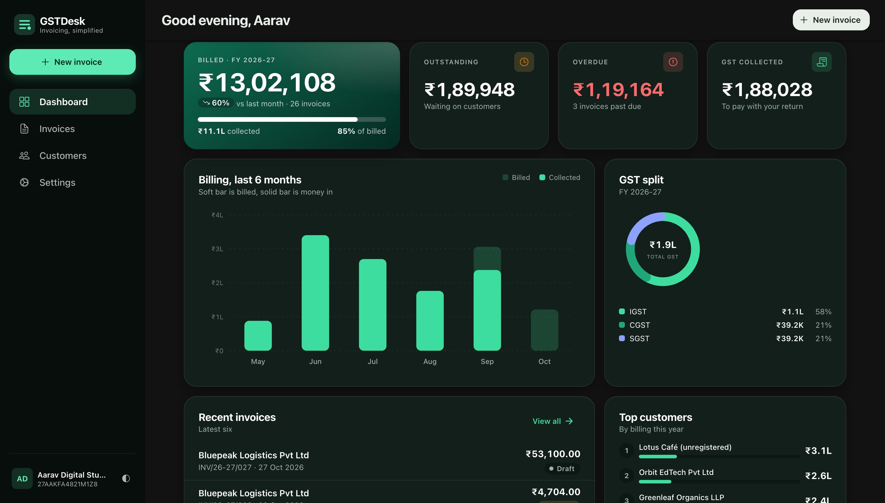
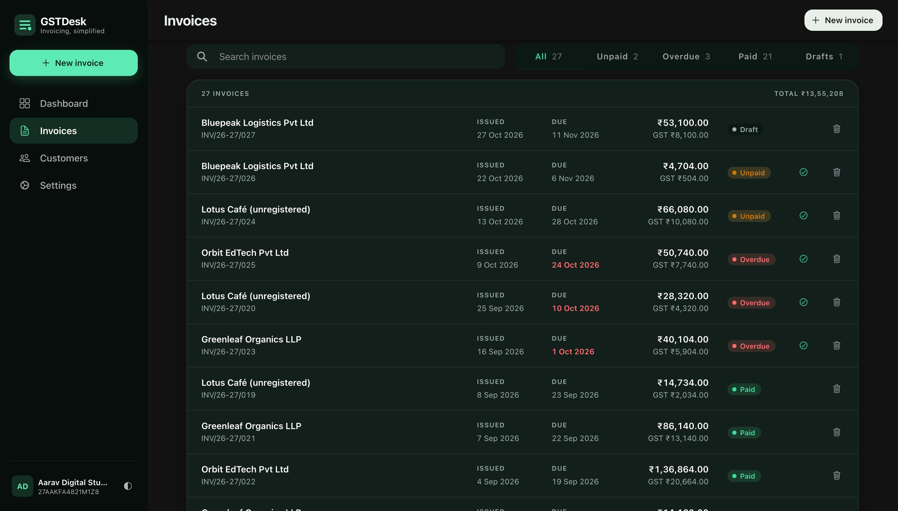
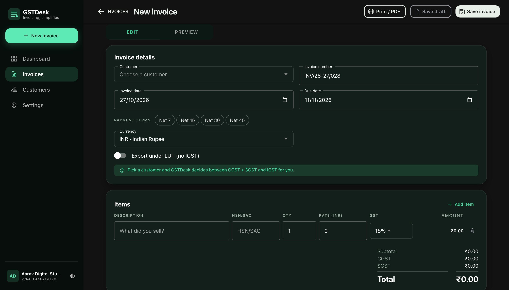
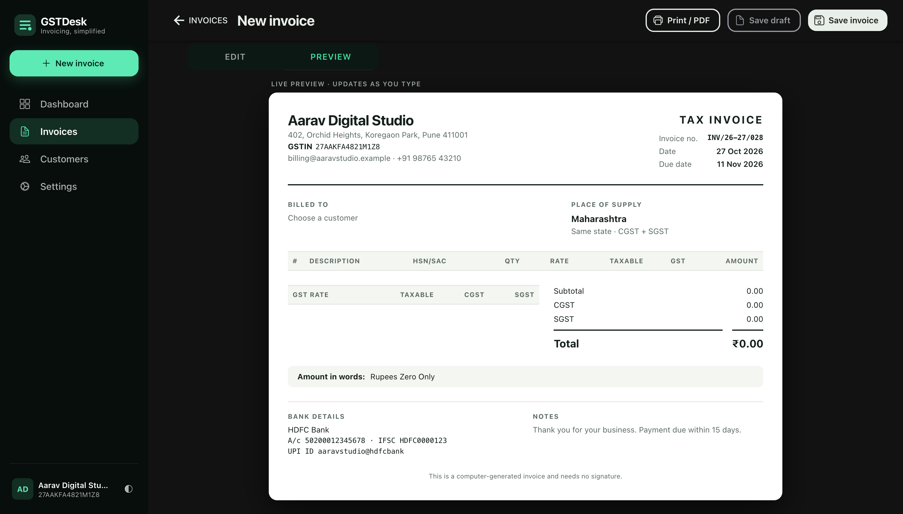
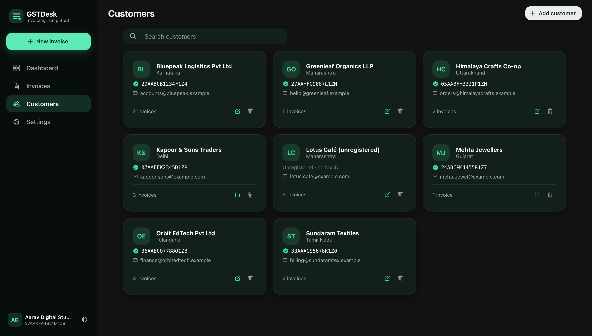
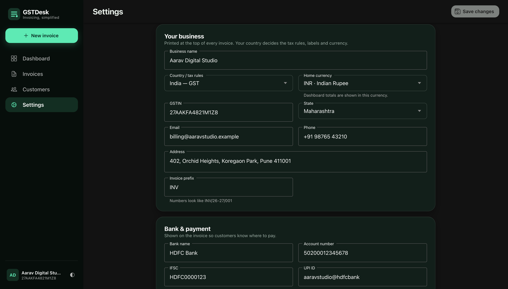
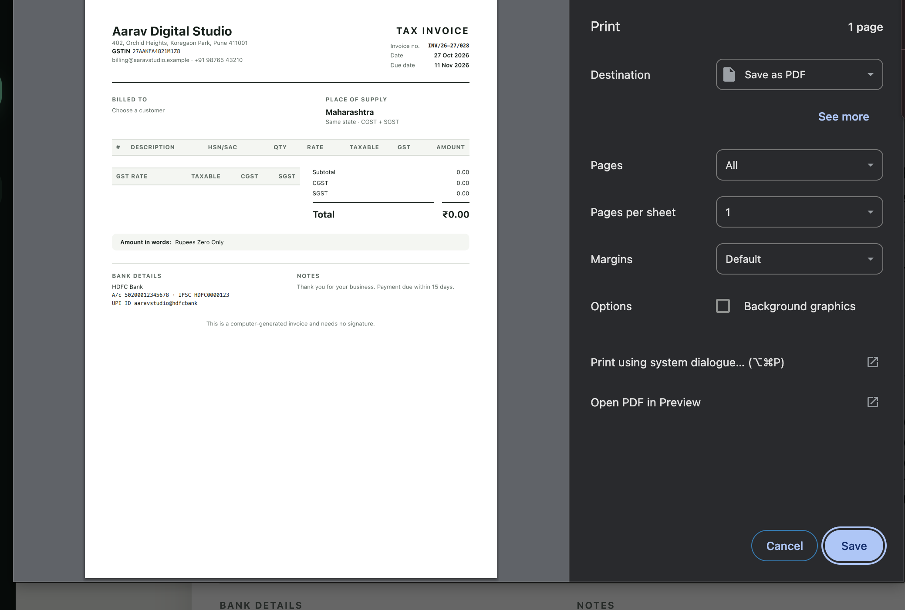
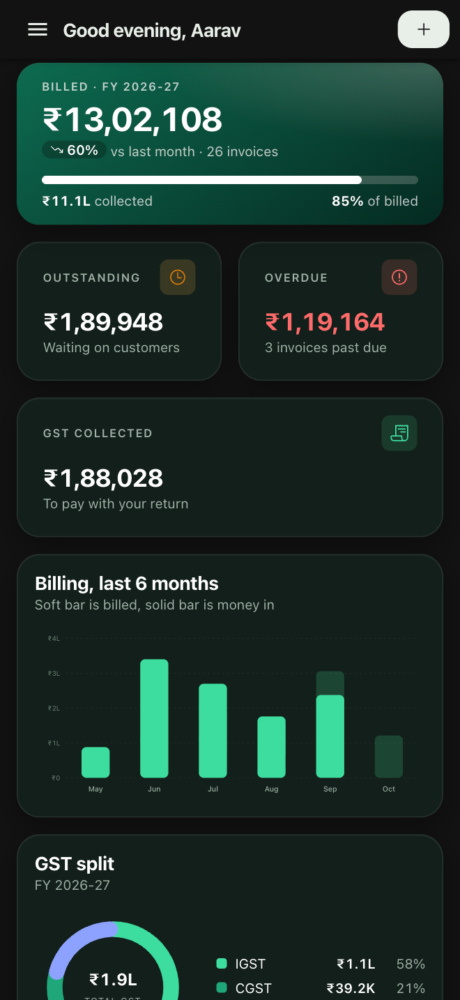
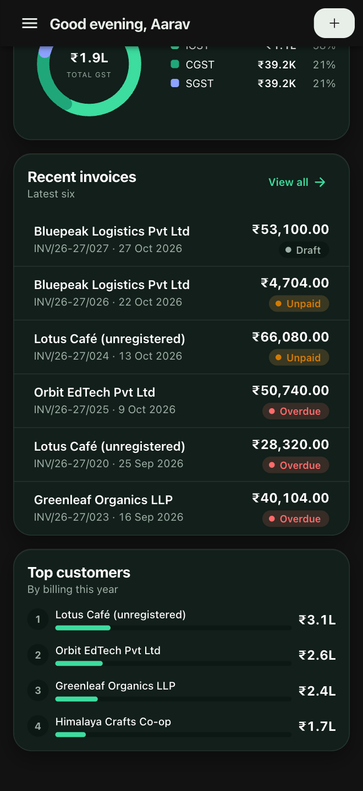
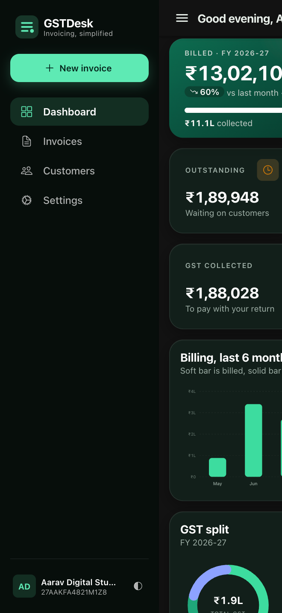

<div align="center">

# GSTDesk

**Offline-first tax invoicing for small businesses, in India and abroad.**
One codebase for desktop (Electron), Android, iOS and the browser.




</div>

> 🎥 **Video walkthrough:** _coming soon_ (YouTube link will be added here)

## What it does

GSTDesk is a desktop-first invoicing app. You set up your business once, add customers, and create tax invoices that pick the right tax split for you. Everything is stored on your device (Capacitor Preferences). There is **no backend, no account and no sign-up**.

- **Correct tax by country.** India GST (CGST + SGST for same-state, IGST for inter-state), US sales tax, UK VAT, EU VAT, Australia GST, Singapore GST, UAE VAT, or a custom regime.
- **Live invoice preview** that updates as you type, with amount in words, bank and UPI details, and place of supply.
- **Print / Save as PDF** on desktop and the native print sheet on mobile.
- **Export invoices** (zero-rated, LUT) with a customer-currency invoice and an exchange rate fetched from the ECB reference rate (optional, or type your own).
- **Dashboard** with billed vs collected, outstanding, overdue, GST collected, a 6-month chart, GST split and top customers.
- **Invoice status tracking:** draft, unpaid, overdue, paid, with search and filters.
- **Customer book** with GSTIN validation, state, email and invoice counts.
- **Backup and restore** your data as a file.
- **Dark and light theme**, responsive from phone to wide desktop.
- **Native shell integration:** deep links (`gstdesk://invoices/new`) and window events for the Electron app.

> **Rates and wording are defaults, not tax advice.** Tax rates, labels and notes such as the LUT export wording are invoicing defaults. Check them with your accountant before you rely on them.

## Screenshots

### Desktop

| Dashboard | Invoices |
| --- | --- |
|  |  |

| New invoice | Live preview |
| --- | --- |
|  |  |

| Customers | Settings |
| --- | --- |
|  |  |

**Print / Save as PDF**



### Mobile

<p>
  
  
  
</p>

## Tech stack

| Area | Choice |
| --- | --- |
| UI | Ionic 9, Angular 22 (standalone components, signals) |
| Native runtime | Capacitor 8 (Android, iOS), `@capawesome/capacitor-electron` (desktop) |
| Storage | Capacitor Preferences, on-device only |
| Printing | `window.print()` on web/desktop, `@capgo/capacitor-printer` on mobile |
| Tests | Vitest + jsdom, a `.spec.ts` beside every page, component, service and util |

## Quick start

Requirements: a current Node.js LTS (22 or newer) and npm.

```bash
git clone https://github.com/Nykz/gstdesk.git
cd gstdesk
npm install      # also installs the electron/ project
npm start        # http://localhost:4200
```

First launch shows a short setup (business name, country and home currency). Sample data is optional.

### Run as a desktop app (Electron)

```bash
npm run build
npx cap sync @capawesome/capacitor-electron
cd electron && npm start
```

Package an installer with `cd electron && npm run pack`.

### Run on Android / iOS

```bash
npm run build && npx cap sync
npx cap open android   # or: npx cap open ios
```

More detail is in the [Android and iOS](#android-and-ios) section below.

## Project docs

- [`docs/prompt.md`](docs/prompt.md): the build prompts used to create the app.
- [`docs/GLOBAL-TAX-BRIEFING.html`](docs/GLOBAL-TAX-BRIEFING.html): the multi-country tax briefing the regimes are based on.

---

## Developer notes

> **Rates and wording are defaults, not tax advice.** Tax rates, labels and notes such as the LUT export wording are invoicing defaults. Check them with your accountant before you rely on them.

## Scripts

| Command | What it does |
| --- | --- |
| `npm start` | Dev server |
| `npm run build` | Production build into `www/` |
| `npm run lint` | ESLint with `angular-eslint` |
| `npm run test:ci` | Unit tests once (`ng test --watch=false`) |
| `npm run verify` | lint + test:ci + build |
| `npm run icons:native` | Builds the Android and iOS app icons and splash screens from `resources/` (run after `ionic cap add android` / `ios`) |

## How country rules work

Each country is one `TaxRegime` object in `src/app/utils/tax-regimes.ts` (India GST, US sales tax, UK VAT, EU VAT, Australia GST, Singapore GST, UAE VAT, and a custom regime). Three engines compute tax line by line and then sum it: `split-by-region` (CGST + SGST or IGST), `single-rate` (VAT/GST) and `manual-rate` (rate typed per line). Components never hard-code a currency symbol, tax name or tax-ID label; they read them from the regime. To add a country, add one object to `TAX_REGIMES` and one spec.

## Structure

```
src/app/
  pages/<name>/        page.ts, page.html, page.scss, page.spec.ts
  components/<name>/   component.ts, .html, .scss, .spec.ts
  services/<name>/     <name>.service.ts and <name>.service.spec.ts
  utils/               pure logic, each with a .spec.ts
  enums/  interfaces/  tokens/
src/testing/           native-mocks.ts (in-memory Preferences and other plugin mocks)
src/theme/variables.scss   all colours, spacing and type tokens
```

Capacitor plugins are only used through the injection tokens in `tokens/native-plugins.tokens.ts`, so specs can swap in the mocks.

## Printing

`printElement()` clones the invoice paper into `#print-root`, adds `is-printing` to `<html>`, calls `window.print()` and cleans up on `afterprint`. `global.scss` carries the A4 `@page` rule. Use the browser's "Save as PDF" to get a PDF.

## Native shell bridge

`NativeShellService` listens for the window events `gstdesk-navigate` (detail = path) and `gstdesk-print`, and for the Capacitor App `appUrlOpen` event (`gstdesk://invoices/new`). It navigates only to `/dashboard`, `/invoices`, `/invoices/new`, `/customers` and `/settings`. In a plain browser nothing fires, so it does nothing.

## First launch, currency and exchange rates

A brand-new install shows a short setup: business name, country (tax rules) and home currency. Nothing is assumed, so a US, UK or Indian business each starts in its own currency; sample data is optional. The home currency is what the dashboard totals and exchange rates are expressed in.

On an invoice for a customer in another country the tax is switched off (export), the invoice moves to the customer's currency, and the exchange rate is "your currency per 1 invoice currency". **Get today's rate** fills it from the European Central Bank reference rate (frankfurter.dev); only the two currency codes are sent. Offline, or for a currency that source does not list, type the rate yourself.

## Android and iOS

| Step | Command |
| --- | --- |
| Build the web app and copy it into both projects | `npm run build && npx cap sync` |
| Regenerate app icons and splash screens from `resources/` | `npm run icons:native` |
| Open in Android Studio / Xcode | `npx cap open android` / `npx cap open ios` |

- Inside the apps, **Export backup** opens the system share sheet (Save to Files, Drive, email) and **Print / PDF** opens the native print sheet, because a web view cannot download or print on its own. Neither needs a permission; importing a backup uses the system file picker.
- The only declared Android permission is `INTERNET` (for the optional exchange-rate lookup). The `gstdesk://` deep link is registered on both platforms.
- Before a store release: set the version (`versionCode` / `versionName` in `android/app/build.gradle`, `MARKETING_VERSION` / `CURRENT_PROJECT_VERSION` in Xcode), sign the Android bundle with your own keystore, and pick your Apple team in Xcode.

